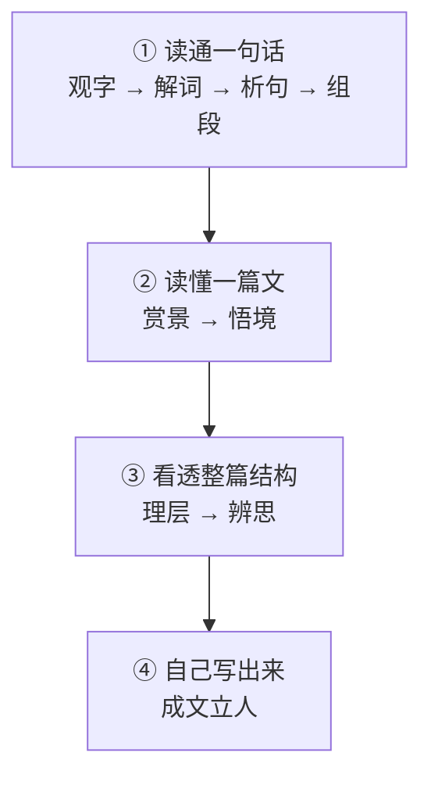
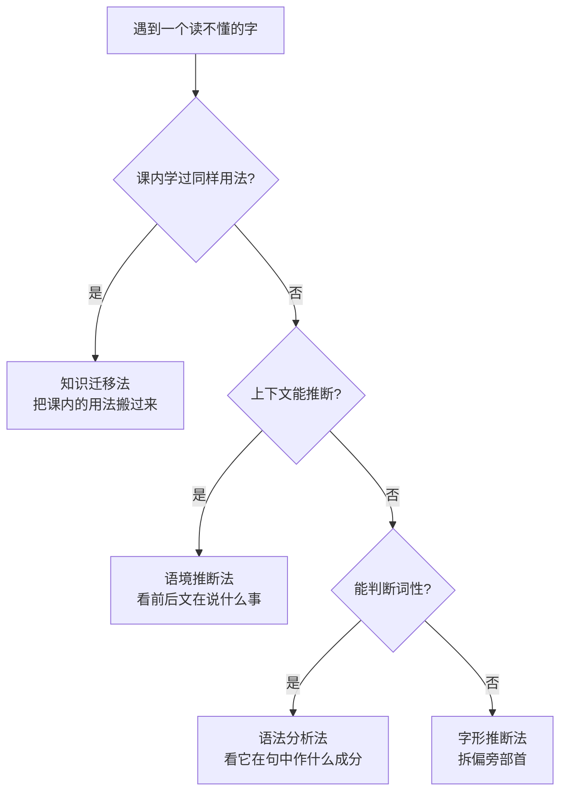
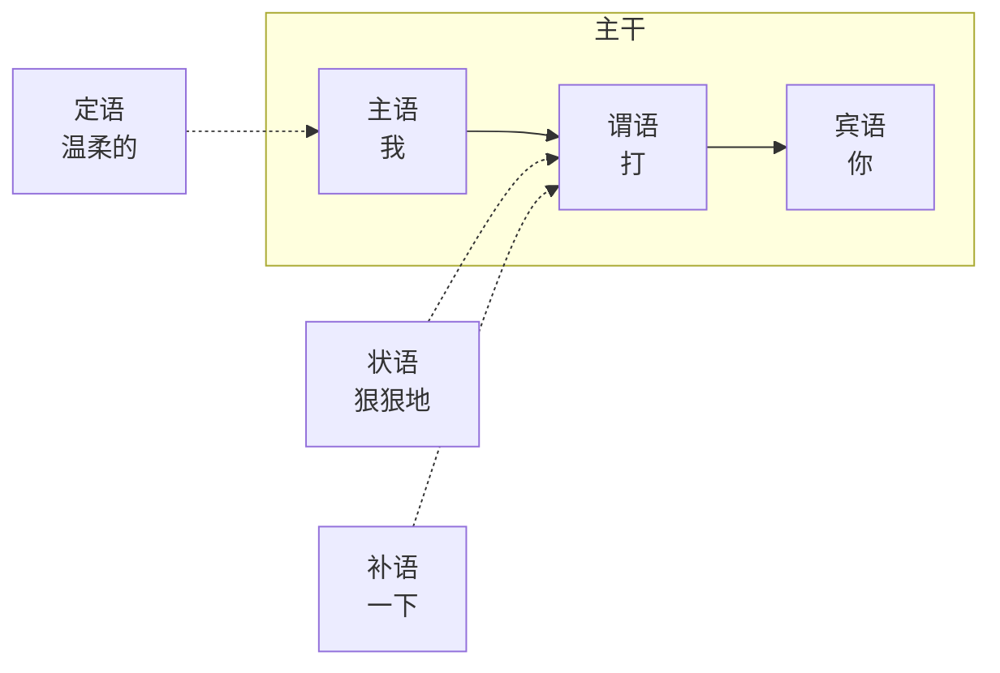
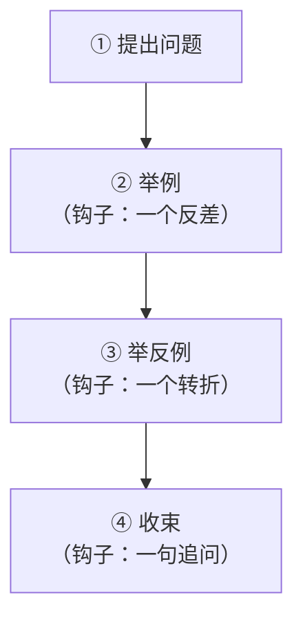
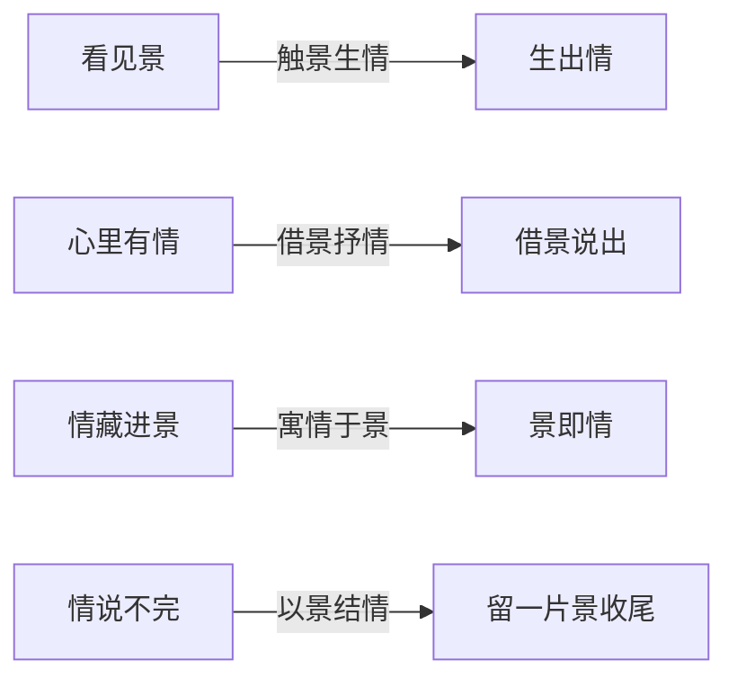
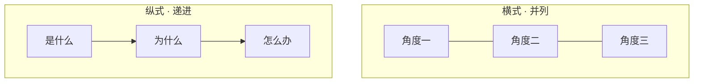
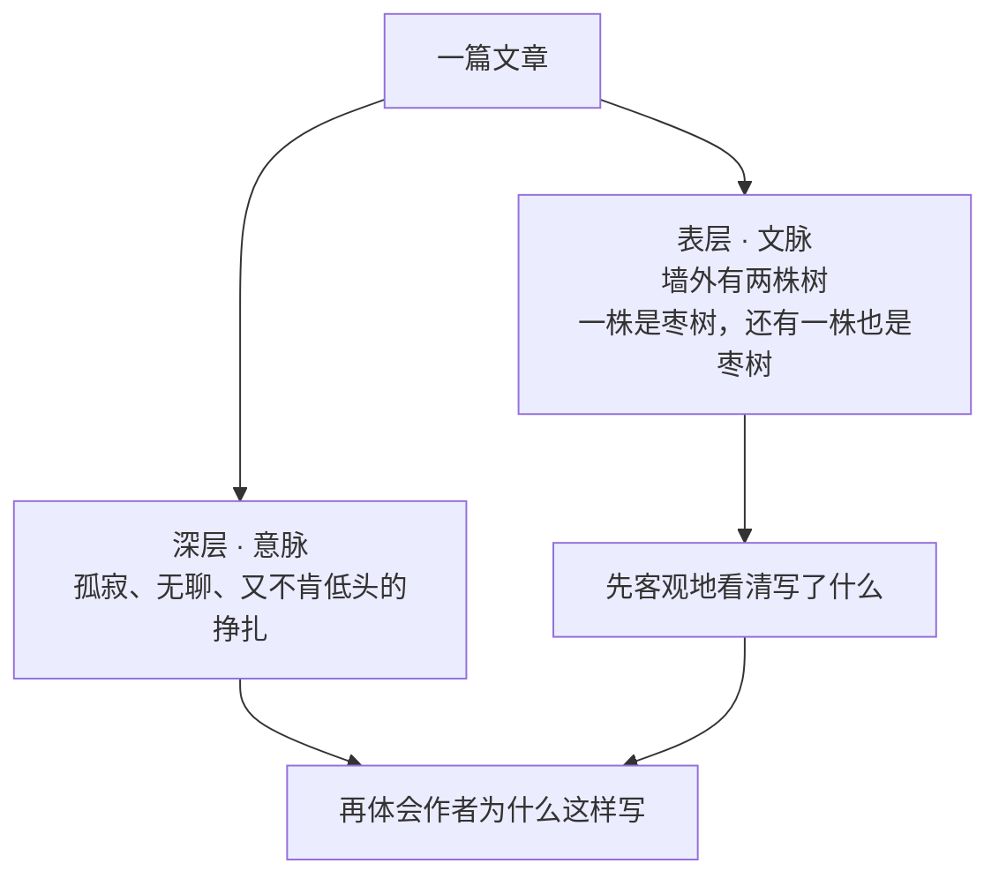
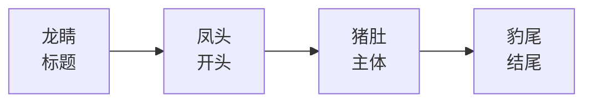

  
拆书笔记 · 一页看懂

  <h1>语文高效学习法</h1>
  
申怡 著 · 北京联合出版公司 · 2022

  
语文不是靠"多读多背"堆出来的。它有九级台阶，每级都有方法。 这份笔记把它拆成一张图、九章要点、五张清单。

  

    
<b>9</b>章 · 九级台阶

    
<b>320</b>页 · 全书篇幅

    
<b>20+</b>年 · 人大附中一线教学

  

## 一分钟看懂

**这本书在解决三个具体问题：**

| 症状 | 你以为的原因 | 作者说真正的原因 |
|---|---|---|
| 阅读题读懂了，答不到点上 | 没背答题模板 | 只看了"点"，没看"面"——没抓文脉和意脉 |
| 古诗文每个字都认识，连起来猜不出 | 文言文太难 | 没掌握"字→词→句"的推断方法 |
| 作文有话想说，写不出深度 | 没天赋、没素材 | 立意、结构、材料缺方法 |

**作者的回答：语文有逻辑，可以拆。**

她把语文拆成九级台阶，从最小的"字"一路走到最大的"文"。每一级都给你可操作的方法，而不是让你背答案。

> 字不离词，词不离句，句不离段，段不离文。

这句话是全书的总开关：**任何一处读不懂，都别在原地死磕，往上或往下一层找答案。**

## 全书骨架：九级台阶

读法建议：**从你最弱的那一级切入**，但别跳级。第 9 章用到的所有能力，前面八章都练过。

## 三条贯穿全书的原则

  

    <h4>① 局部放回整体</h4>
    
"字不离词，词不离句，句不离段，段不离文"。单看一个词没有意义，要看它在句子里干什么活。

  

  

    <h4>② 先文脉，后意脉</h4>
    
先看文章"怎么走的"（结构、顺序、线索），再看"心怎么变的"（情感的起伏）。顺序反了，答案就会飘。

  

  

    <h4>③ 学方法，不背答案</h4>
    
每个方法都要能自己推一遍。技巧是鱼，思维是渔——换一道题就失效的，都不算学会。

  

## 九章逐章拆解

### 第 1 章 · 观字入门

**一句话**：字是语文的第一块砖。字看不懂，后面的词、句、段都没有落脚点。

**两条路径 + 四把工具**

- **纵向**：追本溯源，看汉字是怎么长出来的（象形、指事、会意、形声……）
- **横向**：看偏旁部首猜义——禾与五谷有关，贝与金钱有关，皿与器具有关，纟与丝织品有关，月与肉有关，歹与死亡有关
- **解字四法**：知识迁移法 → 语境推断法 → 语法分析法 → 字形推断法
- **炼字**：古诗里"一字点睛"，一个字定住整首诗的境界

**怎么用**：读古诗时先抓最扎眼的那个动词或形容词，问三句——它画出什么画面？它藏着什么心理？换成近义字，差在哪里？

对应原文：<a href="https://github.com/sijihuaer/studychinese/blob/main/语文高效学习法_全本.md#ch1">第 1 章 · 观字入门</a>

### 第 2 章 · 解词动心

**一句话**：词是作者递过来的表情。读懂了词，才读得懂人。

**解词三大法门**

| 法门 | 看什么 | 能读出什么 |
|---|---|---|
| 实词构筑形象 | 名词 | 人物的身份与处境 |
| | 动词 | 人物的深层心理 |
| | 形容词 | 情绪的温度 |
| 虚词表达态度 | 之、乎、者、也、竟然、不过 | 作者没明说的态度 |
| 注意词语搭配 | 为什么是"春风又<b>绿</b>江南岸" | 一字之差的分寸感 |

**怎么用**：读一句话，圈四样东西——名词、动词、形容词、虚词。名词看人，动词看心，形容词看情绪，虚词看态度。

对应原文：<a href="https://github.com/sijihuaer/studychinese/blob/main/语文高效学习法_全本.md#ch2">第 2 章 · 解词动心</a>

### 第 3 章 · 析句亮眼

**一句话**：句子只有两样东西——主干和枝叶。先剥枝叶，再看主干。

**三把刀**

- **一句话吃透成分**：拿"我打你"练手，主谓宾一目了然
- **细分法**：把句子拆到最小单位 → 文言文断句
- **紧缩法**：砍掉定语、状语、补语，只留主干 → 压缩语段
- **两法合用**：主干读不通，就是病句 → 病句修改

**怎么用**：文言断句先找动词，一个动作一句话；压缩语段先问"谁、干什么"，其余全是枝叶。

对应原文：<a href="https://github.com/sijihuaer/studychinese/blob/main/语文高效学习法_全本.md#ch3">第 3 章 · 析句亮眼</a>

### 第 4 章 · 组段健身

**一句话**：段与段之间要埋"逻辑的钩子"，阅卷老师才会被钩住往下看。

**先说清楚：钩子不是辞藻**

书里的原话很直白——高分作文最基本、最关键的一点，是**文字流畅、合乎逻辑**。阅卷老师几分钟看一篇，能不能让他多停留一会儿，取决于你在语段之间埋了几个小钩子。钩子是逻辑，不是名人名言。

**三种段落任务**

- **破题**：深入原文，抓取关键字词
- **展开**：紧绕主题，把一个问题说通说透
- **综合**：细读语段，联系左右上下一起看

书里的范例是汪曾祺《五味》：从无锡的甜，写到广东的糖水、北京人吃不吃苦瓜，看着像闲聊，其实段段有钩子。

**怎么用**：每写完一段，问自己一句"下一段凭什么接在这里"。接不上，就是没钩子。

对应原文：<a href="https://github.com/sijihuaer/studychinese/blob/main/语文高效学习法_全本.md#ch4">第 4 章 · 组段健身</a>

### 第 5 章 · 赏景美颜

**一句话**：景不是背景板，是作者替自己说出口的情绪。

**四种情景关系**（这是全书最实用的一张表）

| 关系 | 情与景的先后 | 书里的例子 |
|---|---|---|
| **触景生情** | 先看见景，情被勾起来 | 杜甫《登高》 |
| **借景抒情** | 心里先有情，借景说出来 | 杜甫《春望》 |
| **寓情于景** | 不直说，情全化在景里 | 韦应物《滁州西涧》 |
| **以景结情** | 用景收尾，余味最长 | 苏轼《江城子·乙卯正月二十日夜记梦》 |

**怎么用**：读完一首诗，只问一句——情是在景**前**、景**中**，还是景**后**？

对应原文：<a href="https://github.com/sijihuaer/studychinese/blob/main/语文高效学习法_全本.md#ch5">第 5 章 · 赏景美颜</a>

### 第 6 章 · 悟境感怀

**一句话**：意象是零件，意境是整台机器。看懂零件，才说得清机器。

**意象四类**

1. **事物本身引人遐想**：柳、月、雁、酒……
2. **人名地名**：登幽州台，一开口就是千年孤独
3. **源自文学常识**：典故是压缩包，解开才见分量
4. **诗歌中的双关语**：一层意思在字面，一层在言外

**从意象到意境**

- 意境 = 由一个或多个意象共同构成的整体境界
- 相同的意象，不同的流派，意境完全不同（《出塞》《凉州词》同写边塞，气象各异）
- 高手还会**反套路**：故意打破你熟悉的意象搭配

**怎么用**：先列意象清单 → 再问"这些意象共同指向什么情绪" → 最后才下"意境"的结论。顺序别倒。

对应原文：<a href="https://github.com/sijihuaer/studychinese/blob/main/语文高效学习法_全本.md#ch6">第 6 章 · 悟境感怀</a>

### 第 7 章 · 理层正骨

**一句话**：读不懂文章，多半是没先看清骨架。

**读文三步**

1. **明确文体，推知思路**：散文、小说、论述文，走法不一样
2. **拎出线索，厘清思路**：顺藤摸瓜，线索往往是人、物、时间或空间
3. **梳理层次，总结规律**：把"情感怎么一步步走的"写成一条线

**两个好用的工具**

- **小说十二字要诀**：找人物、抓线索、理事件、明结构
- **结构两种基本形式**：横式（并列展开）、纵式（层层递进）

**反向收益**：会拆别人的结构，就会搭自己的骨架。第 9 章的谋篇布局，靠的就是这一章。

对应原文：<a href="https://github.com/sijihuaer/studychinese/blob/main/语文高效学习法_全本.md#ch7">第 7 章 · 理层正骨</a>

### 第 8 章 · 辨思动魄

**一句话**：文脉是看得见的路，意脉是看不见的心。

**先避开两个思维误区**

- **机械唯物主义**：只看表、不看里，只看点、不看面
- **狭隘的功利主义**：不管作者写什么，都硬扣一顶"深刻主题"的帽子

**然后才是正题——两层读法**

| 层次 | 是什么 | 怎么找 |
|---|---|---|
| **文脉**（显性） | 按时间或空间顺序，把外在的行为言谈连起来 | 分段、找线索、看顺序 |
| **意脉**（隐性） | 作者情感连续而曲折的变化过程 | 看情绪在哪儿转、为什么转 |

书里用鲁迅《秋夜》开篇那句"两株枣树"做例子：文脉上看只是重复罗列，意脉上看才见出孤寂与不屈。**这也是全书最像"心法"的一章。**

对应原文：<a href="https://github.com/sijihuaer/studychinese/blob/main/语文高效学习法_全本.md#ch8">第 8 章 · 辨思动魄</a>

### 第 9 章 · 成文立人

**一句话**：作文不是等灵感，是搞工程——立意、结构、材料，各有方法。

**三要素，有优先级**

  
<h4>立意 · 魂魄</h4>
深刻、新颖。先想明白"我要说什么"，标题才有神。

  
<h4>结构 · 骨架</h4>
清晰、合理。龙睛 → 凤头 → 猪肚 → 豹尾。

  
<h4>材料 · 血肉</h4>
真实、典型、新颖、具体。宁少勿滥。

**结构口诀（古人的说法，书里直接拿来用）**

**写作的真实流程**：看（审题）→ 想（用什么结构、怎么展开）→ 写（选套路、选表达）。

**九种套路 / 九条路径 / 九个要点**：原书这三节各配了一张图表，OCR 没能识别出图里的文字，建议查纸书对应页（第 9 章后段）。

对应原文：<a href="https://github.com/sijihuaer/studychinese/blob/main/语文高效学习法_全本.md#ch9">第 9 章 · 成文立人</a>

## 五张随手清单

### 一、读诗四问

1. 这首诗里最扎眼的一个字是哪个？换成近义字，差在哪？
2. 有哪些意象？它们共同指向什么情绪？
3. 情是在景前、景中，还是景后？
4. 哪一句是"以景结情"？

### 二、文言断句三步

1. 先找动词——一个动作就是一句话
2. 再看主语——谁在做这个动作
3. 最后看虚词——之、乎、者、也常常是句子的关节

### 三、现代文阅读的两层读法

1. 先理文脉：分几段？按什么顺序？线索是什么？
2. 再抓意脉：情绪在哪一句转了？为什么转？
3. 答题时：位置靠文脉定，深度靠意脉给

### 四、作文交卷前自检

- 标题是不是"龙睛"？能不能让人想点开？
- 第一段有没有亮出观点？
- 每段之间有没有"钩子"，删掉任意一段会不会垮？
- 材料是真实的、具体的，还是"很多人都说过"的？
- 结尾有没有回扣开头，而不是重复开头？

### 五、每天十分钟

- 每天读一段古文，用"观字 → 解词 → 析句"拆一遍
- 每周完整拆一篇现代文：画文脉线，标意脉转折
- 每两周写一篇，只练一个点（这次只练标题，下次只练钩子）

## 金句摘录

> 掌握语文知识的源起，并能更好地、快速地运用，是为高效。掌握语文知识的本质，能系统地、重复地获取，是为学习。
>
> —— 序言

> 字不离词，词不离句，句不离段，段不离文。
>
> —— 全书反复出现的一句总纲

> 观字，也是观生命，观人生，观世界。
>
> —— 第 1 章

> 读文章，要先理文脉。理清楚了文脉，就能一下子抓住重心，纲举目张。
>
> —— 第 7 章

> 从文脉到意脉，一层层抽丝剥茧，去深入体会作者的心境。
>
> —— 第 8 章

## 怎么用这本书

| 你是谁 | 建议路线 |
|---|---|
| **中学生** | 先做一遍"五张清单"，看自己卡在哪一级，再回对应章节补。别从头抄笔记。 |
| **家长** | 只看第 1、5、8 章，理解"语文考的是读法"这件事，比盯着分数有用。 |
| **语文老师** | 九章就是九套教案骨架；每章的"方法 + 例子 + 独家解答"结构可以直接搬进课堂。 |
| **只想要结论的人** | 记住三条原则（局部放回整体 / 先文脉后意脉 / 学方法不背答案），够用了。 |

<b>关于这份拆书</b>

- 内容依据本仓库的 MinerU 转换全文整理，章节顺序、方法名称、例诗出处均核对过原文。
- 原书 320 页，本页只做"读薄"，不替代原文。深入某一章请直接看 <a href="https://github.com/sijihuaer/studychinese/blob/main/语文高效学习法_全本.md">全本</a>（已埋好 ch1–ch9 锚点，从上方每章的"对应原文"可直接跳转）。
- 第 9 章的三张图表（九种套路 / 九条路径 / 九个要点）在 OCR 中丢字，本页未做臆测，需要请看纸书。
- 文字版权归作者与出版方所有，本页仅供个人学习使用，请勿商用。

